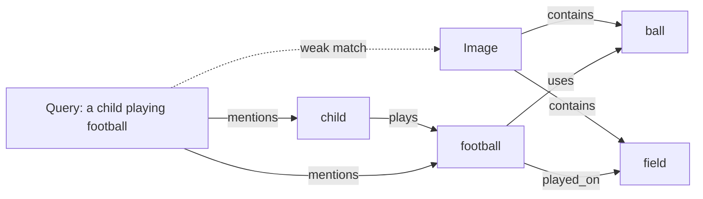
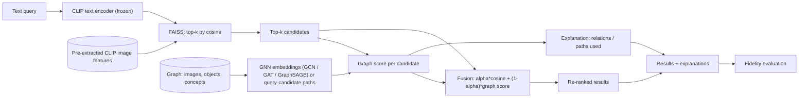
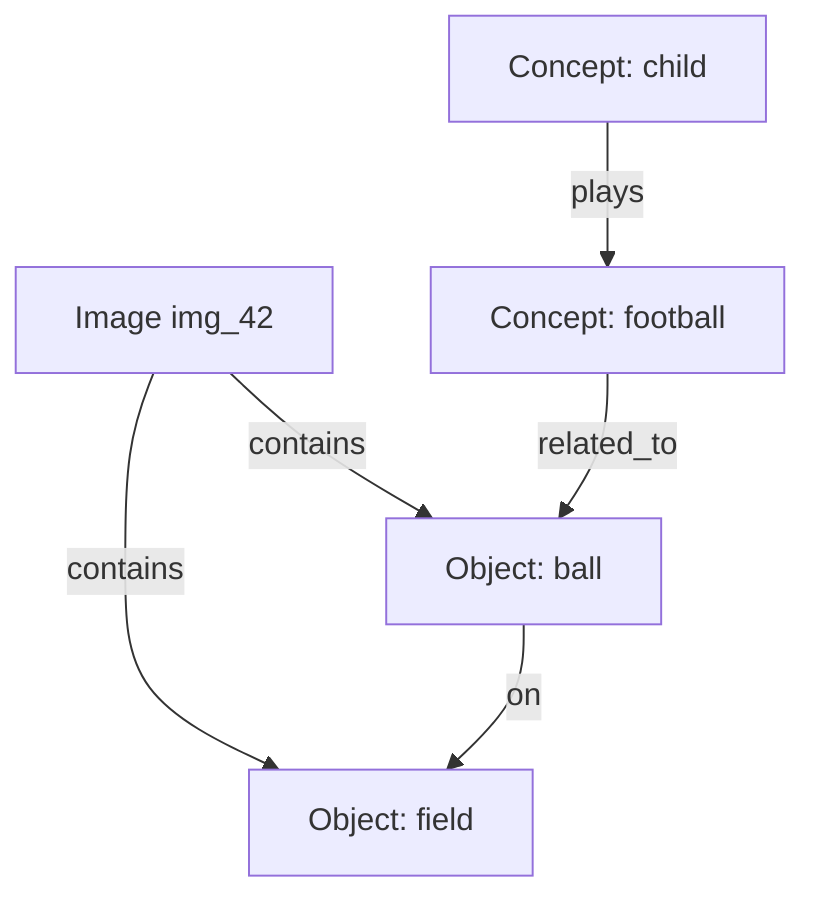

# Project 3 – Truy vấn đa phương thức có giải thích bằng đồ thị

> Đồ án môn **Học máy với dữ liệu đồ thị** (Machine Learning on Graph Data).
> **Nguồn sự thật duy nhất (source of truth):** [`Project03_Multimodal_XAI.pdf`](Project03_Multimodal_XAI.pdf). README này chỉ diễn giải lại đề bài cho dễ hiểu.
> Khi README và PDF khác nhau thì **PDF đúng**.

**Cách đọc tài liệu này:**

- Câu có trích dẫn kiểu **(PDF §5)** = yêu cầu thật của đề, lấy từ mục 5 của PDF.
- Khối có nhãn **💡 Giải thích** hoặc **🧭 Gợi ý** = phần nhóm tự viết thêm cho dễ hiểu. Đây **không phải** yêu cầu của đề.
- Thuật ngữ kỹ thuật (CLIP, FAISS, GCN, Recall@10...) giữ nguyên tiếng Anh để dễ tra cứu. Nghĩa tiếng Việt có trong [Bảng thuật ngữ](#4-bảng-thuật-ngữ).

---

## Mục lục

1. [TL;DR – Tóm tắt trong 1 phút](#1-tldr--tóm-tắt-trong-1-phút)
2. [Vì sao cần đồ thị? (Động lực)](#2-vì-sao-cần-đồ-thị-động-lực)
3. [Các khái niệm nền tảng cho người mới](#3-các-khái-niệm-nền-tảng-cho-người-mới)
4. [Bảng thuật ngữ](#4-bảng-thuật-ngữ)
5. [Pipeline tổng thể](#5-pipeline-tổng-thể)
6. [Dữ liệu và cách xây đồ thị](#6-dữ-liệu-và-cách-xây-đồ-thị)
7. [Ba nhiệm vụ của đồ án](#7-ba-nhiệm-vụ-của-đồ-án)
8. [Chọn nhánh bài toán: A / B / Video](#8-chọn-nhánh-bài-toán-a--b--video)
9. [Bốn cấp độ và điểm trần (checklist)](#9-bốn-cấp-độ-và-điểm-trần-checklist)
10. [Chia dữ liệu và tránh rò rỉ](#10-chia-dữ-liệu-và-tránh-rò-rỉ)
11. [Đánh giá kết quả](#11-đánh-giá-kết-quả)
12. [Giải thích trung thực (xAI) – quy tắc quan trọng nhất](#12-giải-thích-trung-thực-xai--quy-tắc-quan-trọng-nhất)
13. [Sản phẩm cần nộp](#13-sản-phẩm-cần-nộp)
14. [Quy định](#14-quy-định)
15. [Dữ liệu và tài liệu gợi ý](#15-dữ-liệu-và-tài-liệu-gợi-ý)
16. [Gợi ý lộ trình thực hiện](#16-gợi-ý-lộ-trình-thực-hiện)
17. [Bản đồ repo](#17-bản-đồ-repo)
18. [Thành viên / Đóng góp](#18-thành-viên--đóng-góp)

### 🧭 Gợi ý thứ tự đọc

| Bạn là ai | Nên đọc |
|---|---|
| Mới vào, chưa biết gì | §1 → §2 → §3 → §4 → §5 → §7 → §9 |
| Chuẩn bị code | §5 → §6 → §10 → §11 → §12 → §17 |
| Chuẩn bị nộp bài / vấn đáp | §9 → §13 → §14 (và ôn lại §10, §12 vì giảng viên hay hỏi) |

---

## 1. TL;DR – Tóm tắt trong 1 phút

**Chúng ta xây gì?**
Một hệ thống **tìm ảnh bằng câu chữ** (text → image retrieval). Người dùng gõ một câu, ví dụ "a child playing football". Hệ thống trả về các ảnh phù hợp nhất. Hệ thống dùng **đồ thị** để:

1. **Xếp hạng lại** (re-rank) kết quả của CLIP cho chính xác hơn.
2. **Giải thích** vì sao mỗi ảnh được trả về, bằng quan hệ / đường đi / đồ thị con (PDF §1).

**Chúng ta KHÔNG làm gì?**

- Không xây mô hình thị giác lớn từ đầu (PDF §1).
- Không huấn luyện bộ phát hiện đối tượng (object detector) (PDF §4.1).
- CLIP/OpenCLIP được **đóng băng** (frozen, không huấn luyện lại). Đặc trưng ảnh/văn bản trích **một lần** rồi lưu lại (PDF §4.1).
- Không bắt buộc làm web hoàn chỉnh. Một notebook hoặc giao diện nhỏ chạy được là đủ (PDF §3).

**Mục tiêu thật sự:** chứng minh rõ ràng **đồ thị đóng vai trò gì** trong bài toán đa phương thức (PDF §1).

---

## 2. Vì sao cần đồ thị? (Động lực)

CLIP rất giỏi so khớp ảnh với chữ. Nhưng CLIP có hai điểm yếu (PDF §1):

| Điểm yếu của CLIP thuần | Đồ thị giúp gì |
|---|---|
| Chỉ dựa vào **độ giống nhau của vector**. Không biết quan hệ có cấu trúc giữa thực thể, khái niệm, sự kiện. | Đồ thị lưu quan hệ rõ ràng: `child –plays→ football`, `ball –on→ field`. |
| **Không cho biết vì sao** một ảnh được trả về. | Quan hệ / đường đi trong đồ thị chính là lời giải thích. |

### Ví dụ kinh điển của đề (PDF §2)

Truy vấn: **"a child playing football"**.

- Trong ảnh, hệ thống chỉ nhận ra **ball** (quả bóng) và **field** (sân cỏ). Không thấy rõ đứa trẻ.
- CLIP có thể xếp ảnh này thấp, vì bề mặt không khớp lắm.
- Đồ thị tri thức có đường đi `child – plays – football`, và football liên quan tới ball, field.
- Nhờ đường đi đó, hệ thống nối được truy vấn với đúng bức ảnh.

Loại truy vấn này gọi là **truy vấn gián tiếp** (indirect query). Mô hình chỉ dựa vào tương đồng vector thường bỏ sót chúng (PDF §2).



*Mô tả:* Truy vấn nhắc tới `child` và `football`. Ảnh chỉ chứa `ball` và `field`. So khớp trực tiếp giữa truy vấn và ảnh thì yếu (nét đứt). Nhưng trong đồ thị có đường đi `Query → football → ball ← Image`, nên hệ thống tìm ra mối liên hệ và cũng dùng chính đường đi này để giải thích. (💡 Các nhãn cạnh `uses`, `played_on` chỉ là ví dụ minh họa, không lấy từ đề.)

---

## 3. Các khái niệm nền tảng cho người mới

> 💡 **Giải thích** – toàn bộ mục này là phần nhóm viết thêm để người mới hiểu. Không phải yêu cầu của đề.

### 3.1. Truy vấn đa phương thức (multimodal retrieval)

"Phương thức" (modality) = loại dữ liệu: chữ, ảnh, video, âm thanh.
"Đa phương thức" = truy vấn một loại, kết quả là loại khác. Ví dụ gõ chữ để tìm ảnh.

### 3.2. Embedding và không gian vector

**Embedding** (nhúng) = biến một thứ (câu, ảnh, đỉnh đồ thị) thành **một dãy số**, ví dụ 512 số.
Hãy tưởng tượng mỗi ảnh và mỗi câu là **một điểm** trong một không gian nhiều chiều. Hai thứ có nghĩa giống nhau thì nằm **gần nhau**.

### 3.3. Cosine similarity (độ tương đồng cosine)

Cách đo hai vector "gần nhau" cỡ nào, dựa vào **góc** giữa chúng.

- Gần 1 → rất giống nhau.
- Gần 0 → không liên quan.

Công thức: `cos(u, v) = (u · v) / (‖u‖ · ‖v‖)`.

### 3.4. CLIP

Mô hình của OpenAI (ICML 2021), đã được huấn luyện sẵn trên rất nhiều cặp ảnh–chú thích. CLIP có **hai bộ mã hóa** (encoder): một cho ảnh, một cho chữ. Cả hai đưa vào **cùng một không gian vector**, nên có thể so ảnh với chữ bằng cosine. **OpenCLIP** là bản mã nguồn mở tương tự.

Trong đồ án, CLIP **đóng băng** (frozen): chỉ dùng để trích đặc trưng, không huấn luyện lại.

### 3.5. FAISS và top-k láng giềng gần nhất

Có hàng chục nghìn ảnh. So truy vấn với từng ảnh rất chậm.
**FAISS** (thư viện của Meta) giúp tìm nhanh **k vector gần nhất** (top-k nearest neighbours). Ví dụ k = 100: lấy 100 ảnh giống truy vấn nhất làm **ứng viên** (candidates).

### 3.6. Re-ranking (xếp hạng lại)

Bước 1 lấy nhanh 100 ứng viên bằng CLIP. Bước 2 tính thêm **điểm đồ thị** cho từng ứng viên rồi **sắp xếp lại**. Giống như vòng sơ tuyển (CLIP) rồi vòng chung kết (CLIP + Graph).

### 3.7. Đồ thị: node, edge, triple

| Khái niệm | Nghĩa | Ví dụ |
|---|---|---|
| **Node** (đỉnh) | Một "thứ" | ảnh `img_42`, đối tượng `ball`, khái niệm `football` |
| **Edge** (cạnh) | Quan hệ nối hai đỉnh | `img_42 –contains→ ball` |
| **Triple** (bộ ba) | Cách ghi một cạnh: (đầu, quan hệ, đuôi) | `(child, plays, football)` |

### 3.8. Knowledge graph, MMKG, scene graph

| Loại đồ thị | Nghĩa đơn giản | Ví dụ dữ liệu |
|---|---|---|
| **Knowledge graph – KG** (đồ thị tri thức) | Mạng lưới các sự thật dạng triple về thế giới | ConceptNet, Wikidata |
| **MMKG** – Multi-Modal Knowledge Graph (đồ thị tri thức đa phương thức) | KG mà các thực thể có kèm ảnh / văn bản | FB15k-237-IMG, MKG-W, MKG-Y |
| **Scene graph** (đồ thị cảnh) | Đồ thị mô tả **một bức ảnh**: đối tượng nào, quan hệ gì | Visual Genome: `man –riding→ horse` |

### 3.9. Path và subgraph

- **Path** (đường đi) = chuỗi cạnh nối liên tiếp: `query → football → ball → img_42`.
- **Subgraph** (đồ thị con) = một phần nhỏ của đồ thị lớn, gồm vài đỉnh và cạnh liên quan.

Đề yêu cầu giải thích bằng **quan hệ, đường đi hoặc đồ thị con** (PDF §1).

### 3.10. GNN và message passing (GCN / GAT / GraphSAGE)

**GNN** (Graph Neural Network, mạng nơ-ron đồ thị) học embedding cho mỗi đỉnh bằng cách **"nghe hàng xóm"**:

1. Mỗi đỉnh nhận thông tin (message) từ các đỉnh kề.
2. Gộp lại, cập nhật biểu diễn của chính nó.
3. Lặp lại vài lớp → đỉnh "biết" về vùng lân cận xa hơn.

Quá trình này gọi là **message passing** (truyền thông điệp).

| Mô hình | Cách gộp thông tin hàng xóm (diễn giải đơn giản) |
|---|---|
| **GCN** | Lấy trung bình (có chuẩn hóa) của hàng xóm |
| **GAT** | Dùng **attention**: hàng xóm quan trọng hơn thì có trọng số lớn hơn |
| **GraphSAGE** | Lấy mẫu một số hàng xóm rồi gộp, chạy tốt trên đồ thị lớn |

Đề yêu cầu dùng **ít nhất 1** trong 3 mô hình này ở cấp độ 1 (PDF §5).

### 3.11. Kết hợp điểm (score fusion)

Điểm cuối của mỗi ứng viên (PDF §4.2):

```
điểm = α · cosine + (1 − α) · điểm_đồ_thị
```

- `cosine`: độ giống nhau từ CLIP.
- `điểm_đồ_thị`: lấy từ embedding GCN/GAT/GraphSAGE trên đồ thị đã xây.
- `α` (alpha), từ 0 đến 1: α = 1 → chỉ dùng CLIP; α = 0 → chỉ dùng đồ thị.
- α và mọi siêu tham số chọn trên **tập validation** (PDF §4.2, §6).

💡 Ví dụ: α = 0.7, cosine = 0.30, điểm đồ thị = 0.80 → điểm = 0.7·0.30 + 0.3·0.80 = 0.21 + 0.24 = **0.45**.

### 3.12. Truy vấn trực tiếp và gián tiếp

| Loại | Nghĩa | Ví dụ |
|---|---|---|
| **Trực tiếp** (direct) | Những gì được nhắc trong câu **nhìn thấy rõ** trong ảnh | "a dog on a sofa" – ảnh có chó và sofa |
| **Gián tiếp** (indirect) | Cần **suy luận qua quan hệ** mới nối được | "a child playing football" – ảnh chỉ có ball + field |

Từ cấp độ 2, phải báo cáo **tách riêng** hai nhóm này (PDF §5, §7).

### 3.13. Chỉ số đánh giá: Recall@K, MRR, nDCG

| Chỉ số | Câu hỏi nó trả lời | Ví dụ |
|---|---|---|
| **Recall@K** | Ảnh đúng có nằm trong **top-K** kết quả không? | Ảnh đúng ở hạng 3 → Recall@1 = 0, Recall@5 = 1, Recall@10 = 1 |
| **MRR** (Mean Reciprocal Rank) | Ảnh đúng **đầu tiên** đứng hạng mấy? Lấy 1/hạng rồi trung bình qua các truy vấn | Hạng 1 → 1.0; hạng 2 → 0.5; hạng 4 → 0.25 |
| **nDCG** | Chất lượng **cả danh sách**, ảnh đúng ở hạng cao được thưởng nhiều hơn; hỗ trợ nhiều mức độ phù hợp | Dùng khi một truy vấn có nhiều ảnh đúng |

Đề yêu cầu Recall@1/5/10 và MRR là chuẩn; nDCG là mở rộng (PDF §7).

### 3.14. Ablation (thí nghiệm cắt bỏ)

Bỏ đi một thành phần để xem nó có thật sự quan trọng không. Trong đồ án:

- **Drop edges**: bỏ cạnh.
- **Shuffle edges**: xáo trộn cạnh.
- **Random graph / random edges**: thay bằng đồ thị/cạnh ngẫu nhiên.

Nếu thay đồ thị thật bằng đồ thị ngẫu nhiên mà kết quả **vẫn tốt y như cũ**, thì cải thiện **không** đến từ cấu trúc quan hệ. Đó là điều đề muốn kiểm tra (PDF §5, §7).

### 3.15. xAI và giải thích trung thực

**xAI** (Explainable AI, AI có giải thích) = AI phải cho biết **vì sao** ra kết quả.
Xem kỹ ở [§12](#12-giải-thích-trung-thực-xai--quy-tắc-quan-trọng-nhất): giải thích phải **thật sự** ảnh hưởng tới thứ hạng, không được "bịa" sau.

### 3.16. Data leakage và seed

- **Data leakage** (rò rỉ dữ liệu) = thông tin từ tập test lọt vào quá trình huấn luyện/chọn tham số. Kết quả sẽ đẹp giả tạo. Xem [§10](#10-chia-dữ-liệu-và-tránh-rò-rỉ).
- **Seed** (hạt giống ngẫu nhiên) = con số cố định cho bộ sinh ngẫu nhiên. Cùng seed → chạy lại ra cùng kết quả. Đề yêu cầu ít nhất 3 seed (PDF §6).

---

## 4. Bảng thuật ngữ

| Thuật ngữ | Nghĩa tiếng Việt / giải thích ngắn |
|---|---|
| Multimodal retrieval | Truy vấn đa phương thức: dùng chữ tìm ảnh hoặc ngược lại |
| Text-to-image / image-to-text | Chữ tìm ảnh / ảnh tìm chữ |
| Embedding | Vector số biểu diễn một đối tượng |
| Encoder | Bộ mã hóa: biến dữ liệu thành embedding |
| Frozen | Đóng băng: dùng mô hình, không cập nhật trọng số |
| Cosine similarity | Độ tương đồng theo góc giữa hai vector |
| CLIP / OpenCLIP | Mô hình ảnh–chữ tiền huấn luyện |
| FAISS | Thư viện tìm láng giềng gần nhanh |
| Top-k | k kết quả tốt nhất |
| Candidate | Ứng viên: ảnh được chọn ở vòng đầu |
| Re-ranking | Xếp hạng lại |
| Node / Edge / Triple | Đỉnh / Cạnh / Bộ ba (đầu, quan hệ, đuôi) |
| Knowledge graph (KG) | Đồ thị tri thức |
| MMKG | Đồ thị tri thức đa phương thức |
| Scene graph | Đồ thị cảnh của một bức ảnh |
| Path / Subgraph | Đường đi / Đồ thị con |
| Static graph | Đồ thị tĩnh: xây một lần, không đổi khi chạy |
| Heterogeneous graph | Đồ thị dị thể: nhiều loại đỉnh, nhiều loại cạnh |
| GNN / GCN / GAT / GraphSAGE | Mạng nơ-ron đồ thị và các biến thể |
| Message passing | Truyền thông điệp giữa các đỉnh kề |
| Score fusion | Kết hợp điểm CLIP và điểm đồ thị |
| α (alpha) | Trọng số kết hợp |
| Direct / indirect query | Truy vấn trực tiếp / gián tiếp |
| Recall@K, MRR, nDCG | Các chỉ số đánh giá xếp hạng |
| Ablation | Thí nghiệm cắt bỏ thành phần |
| xAI | AI có giải thích |
| Fidelity / Validity / Sparsity | Độ trung thực / Tính hợp lệ / Độ gọn của giải thích |
| Post-hoc rationalisation | Hợp lý hóa sau: bịa lời giải thích sau khi đã có kết quả |
| Data leakage | Rò rỉ dữ liệu |
| Seed | Hạt giống ngẫu nhiên |
| Train / validation / test split | Chia tập huấn luyện / kiểm định / kiểm tra |
| Transferability | Khả năng chuyển giao sang dữ liệu/miền khác |
| Data card | Thẻ mô tả bộ dữ liệu: nguồn, cách tạo, giấy phép |

---

## 5. Pipeline tổng thể

Quy trình do đề mô tả (PDF §4.2):



*Mô tả:* Truy vấn chữ được CLIP mã hóa thành vector. FAISS so vector này với đặc trưng ảnh đã trích sẵn và lấy top-k ứng viên theo cosine. Với mỗi ứng viên, hệ thống tính điểm đồ thị (từ embedding GNN, hoặc từ đường đi nối truy vấn với ứng viên). Điểm cuối = α·cosine + (1−α)·điểm đồ thị, rồi xếp hạng lại. Các quan hệ/đường đi **đã dùng để tính điểm đồ thị** được trả kèm làm giải thích. Cuối cùng đánh giá fidelity của giải thích.

**Kiến trúc cấp độ 1 nên giữ đơn giản** (PDF §4.2):

- Điểm cuối = kết hợp có trọng số giữa CLIP và điểm đồ thị.
- Điểm đồ thị lấy từ embedding GCN/GAT/GraphSAGE trên đồ thị đã xây.
- Giải thích = các quan hệ/đường đi đóng góp vào điểm đồ thị của ứng viên đó.
- Nhóm **được phép** điều chỉnh cấu trúc đồ thị và cách kết hợp điểm, **nếu giải thích được cơ chế**.

---

## 6. Dữ liệu và cách xây đồ thị

### 6.1. Dữ liệu đầu vào (PDF §4.1)

| Thành phần | Cách làm theo đề |
|---|---|
| Ảnh + văn bản đi kèm | Caption, mô tả. Đặc trưng trích **một lần** bằng CLIP/OpenCLIP đóng băng và lưu lại. Tìm láng giềng bằng FAISS. |
| Liên kết ảnh ↔ thực thể/khái niệm | Dùng scene graph có sẵn (Visual Genome), ảnh gắn thực thể có sẵn (FB15k-237-IMG), nhãn đối tượng của dữ liệu, hoặc detector tiền huấn luyện. **Không huấn luyện detector.** |
| Quan hệ giữa thực thể/khái niệm | Lấy từ chính dữ liệu (scene graph, triple của KG), hoặc bổ sung từ ConceptNet/Wikidata. |

### 6.2. Xây đồ thị (PDF §4.2)

| Thành phần | Nội dung |
|---|---|
| **Đỉnh** | ảnh; thực thể/đối tượng; khái niệm |
| **Cạnh** | `ảnh –contains→ đối tượng`; quan hệ giữa đối tượng trong scene graph; quan hệ giữa khái niệm từ KG ngoài (ConceptNet/Wikidata) |
| **Cấp độ 1** | Chỉ cần **đồ thị tĩnh** xây từ dữ liệu có sẵn |
| **Mở rộng** | MMKG dị thể đầy đủ, đồ thị đa quan hệ phức tạp |



*Mô tả:* Ví dụ một mảnh đồ thị nhỏ. Cạnh `contains` nối ảnh với đối tượng trong ảnh. Cạnh `on` là quan hệ trong scene graph. Cạnh `related_to`, `plays` là quan hệ khái niệm lấy từ KG ngoài như ConceptNet. (💡 Tên cạnh cụ thể chỉ là minh họa.)

---

## 7. Ba nhiệm vụ của đồ án

Ba nhiệm vụ nối tiếp nhau, đi từ truy vấn đến giải thích (PDF §1):

| # | Nhiệm vụ | Câu hỏi cần trả lời | Đầu vào → Đầu ra | Chỉ số chính |
|---|---|---|---|---|
| 1 | **Truy vấn đa phương thức**: dùng CLIP tiền huấn luyện truy vấn văn bản–ảnh và dựng pipeline đánh giá chuẩn | Kết quả nào phù hợp nhất với truy vấn? | Câu truy vấn → danh sách top-k ảnh | Recall@1/5/10, MRR (PDF §7) |
| 2 | **Cải thiện bằng đồ thị**: liên kết ảnh/văn bản với thực thể, khái niệm trong MMKG hoặc scene graph; dùng học máy đồ thị để xếp hạng lại | Tri thức quan hệ giúp ở đâu, nhất là với truy vấn gián tiếp? | Top-k từ CLIP + đồ thị → top-k đã xếp hạng lại | So CLIP vs CLIP+Graph; tách trực tiếp/gián tiếp; ablation (PDF §7) |
| 3 | **Giải thích (xAI)**: chỉ ra quan hệ/đường đi/đồ thị con đã tham gia xếp hạng và đánh giá mức trung thực | Vì sao mô hình trả về kết quả này? | Một kết quả → quan hệ/đường đi đã dùng | Phân tích 5 thành công + 5 thất bại; fidelity/validity/sparsity (PDF §7) |

💡 **Ví dụ xuyên suốt:**

- NV1: gõ "a child playing football" → CLIP trả `img_42` ở hạng 15.
- NV2: điểm đồ thị của `img_42` cao nhờ đường đi tới `football` → sau re-rank, `img_42` lên hạng 2.
- NV3: giải thích "`img_42` được đẩy lên nhờ `child –plays→ football –related_to→ ball ←contains– img_42`". Kiểm tra: bỏ đường đi này thì `img_42` phải tụt hạng.

---

## 8. Chọn nhánh bài toán: A / B / Video

| Nhánh | Bài toán | Mức |
|---|---|---|
| **A. Văn bản tìm ảnh** | Text-to-image. Nhánh chuẩn, dễ triển khai, **bắt buộc để bắt đầu** | Cấp độ 1–3 |
| **B. Hai chiều** | Thêm ảnh tìm văn bản/mô tả (image-to-text) hoặc cả hai chiều; **vẫn phải báo cáo đầy đủ nhánh A** | Mở rộng |
| **Video** | Text-to-video: lấy mẫu khung hình, trích đặc trưng bằng mô hình tiền huấn luyện, gộp theo thời gian | Điểm cộng |

Nguồn: PDF §3. Không bắt buộc web hoàn chỉnh; notebook hoặc giao diện nhỏ chạy được là đủ.

---

## 9. Bốn cấp độ và điểm trần (checklist)

**Điểm trần** = điểm tối đa có thể đạt nếu dừng ở cấp độ đó. Nguồn: PDF §5.

| Cấp độ | Nhiệm vụ | Điểm trần |
|---|---|---|
| 1 | Nhiệm vụ 1 và 2 | **7.0** |
| 2 | Nhiệm vụ 2 (nâng cao) | **8.5** |
| 3 | Nhiệm vụ 3 (xAI) + dữ liệu tự xây | **10** |
| 4 | Mở rộng tự chọn | **+1.0 – 2.0** |

### Cấp độ 1 – trần 7.0

- [x] Trên **ít nhất 1 tập công khai**. → Visual Genome, split cố định `splits/visual_genome/split_seed0.json` (ADR-0042)
- [x] Baseline **CLIP đóng băng**. → dòng `clip_vg` trong `results/tables/main.csv` (ADR-0043)
- [x] Dựng đồ thị từ dữ liệu có sẵn (scene graph Visual Genome, FB15k-237-IMG, hoặc từ nhãn). → đỉnh khái niệm là synset Visual Genome, cạnh `contains` từ CLIP top-16 (ADR-0045, ADR-0046), `docs/guides/xay-do-thi.md`
- [x] Áp dụng **ít nhất 1** thuật toán đã học: GCN / GAT / GraphSAGE. → GraphSAGE một lớp (ADR-0046), `src/mmxai/models/sage.py`
- [x] Xếp hạng lại bằng cách kết hợp điểm CLIP và điểm đồ thị. → `alpha` chọn trên val (ADR-0047), `src/mmxai/rerank/fusion.py`
- [x] So sánh **CLIP** với **CLIP + Graph** trên **cùng cách chia**. → `results/tables/main.csv`, có đối chứng không đồ thị; xem `docs/guides/huan-luyen-va-xep-hang-lai.md` §6
- [x] **Ablation cơ bản**: bỏ cạnh hoặc thay bằng cạnh ngẫu nhiên, để chứng minh cải thiện đến từ cấu trúc quan hệ. → bỏ cạnh: `clip_nograph_vg`; cạnh xáo giữ bậc: `clip_graph_vg_lr1e4_shuffled`; xem `docs/guides/huan-luyen-va-xep-hang-lai.md` mục 7, "Ablation"
- [x] **Giải thích cơ bản**: hiển thị quan hệ/đường đi dùng khi xếp hạng cho một số truy vấn. → `scripts/explain.py` (Occlusion trên chính mô hình đã xếp hạng, ADR-0016)
- [x] Phân tích **5 truy vấn thành công** và **5 truy vấn thất bại**. → bản nháp trên val: `reports/case_studies/5-thanh-cong-5-that-bai.md` (nhóm cần viết lại cho báo cáo)
- [x] **Mở rộng NV1 (tùy chọn)**: nDCG@10, chiều ảnh → văn bản (`alpha_image_to_text` chọn trên val), và phân nhóm truy vấn (`specificity`, `relation`). → ADR-0049, bảng `results/tables/eval2_{text_to_image,image_to_text,groups}.csv`, hồ sơ `results/records/20261113_cap-do-1-mo-rong/`

### Cấp độ 2 – trần 8.5

- [ ] Thực nghiệm trên **ít nhất 2 tập công khai**.
- [ ] Triển khai hoặc tái lập **1 phương pháp mới từ năm 2024 trở lại đây** về multimodal KG, graph-enhanced retrieval hoặc explainable graph retrieval. Chỉ cần 1. Ví dụ: NativE (SIGIR 2024), AdaMF-MAT (LREC-COLING 2024), Mixed-Curvature MMKGC (AAAI 2025) (PDF §2, §10).
- [ ] Đánh giá trên **cùng pipeline và cách chia** của cấp độ 1.
- [ ] Xây bộ **tối thiểu 20 truy vấn đánh giá**, có nhóm **truy vấn gián tiếp** (kiểu child – plays – football).
- [ ] Báo cáo **tách riêng** nhóm trực tiếp và nhóm gián tiếp.

### Cấp độ 3 – trần 10

- [ ] Đánh giá giải thích **định lượng**: **fidelity**, **validity**, **sparsity**, bằng chứng cụ thể cho **tối thiểu 10 truy vấn**.
  - Fidelity theo đề: bỏ hoặc làm nhiễu cạnh/đường đi dùng làm giải thích thì điểm hoặc thứ hạng phải thay đổi theo hướng hợp lý.
- [ ] **Tự xây một MMKG nhỏ** cho một miền hẹp, **ưu tiên tiếng Việt**. Quy mô gợi ý: **50–150 thực thể**, **300–1.000 triple**, **200–500 ảnh**. → đã thu thập, dựng và duyệt sơ bộ bằng AI (119 thực thể, 302 triple, 382 ảnh; chờ nhóm kiểm các dòng bị `drop`): `mmkg/`, `data_cards/mmkg_vi.md`, ADR-0050, ADR-0051
- [ ] Chạy **phương pháp tốt nhất** từ cấp độ 1/2 trên dữ liệu này.
- [ ] Mô tả nguồn dữ liệu, cách liên kết ảnh – thực thể.
- [ ] Phân tích **khả năng chuyển giao** (transferability).

### Cấp độ 4 – điểm cộng +1.0 đến +2.0

Đề xuất cải tiến riêng theo **một** trong các hướng:

- [ ] **(a) Thuật toán**: graph-aware contrastive loss; chọn cặp dương/âm theo khoảng cách đồ thị; cơ chế re-rank hoặc kết hợp điểm thích nghi; cách chọn đường đi giải thích. → **Bắt buộc**: có giả thuyết, ablation, thực nghiệm trên **ít nhất 2 tập công khai**.
- [ ] **(b) Mở rộng video** (text-to-video).
- [ ] **(c) Khảo sát người dùng có đối chứng** về mức hữu ích của giải thích.

Ngoài ra: áp dụng công trình mới năm **2026**, hoặc có bản thảo bài báo đã nộp tới hội nghị/tạp chí có phản biện, cũng được tính điểm cộng.

---

## 10. Chia dữ liệu và tránh rò rỉ

Nguồn: PDF §6. Cột "Vì sao" là 💡 giải thích của nhóm.

| # | Quy tắc (PDF §6) | 💡 Vì sao |
|---|---|---|
| 1 | Ảnh ứng viên và truy vấn của **tập test** không được dùng để huấn luyện lớp chiếu, chọn siêu tham số, hay xây cạnh thống kê. | Nếu mô hình đã "nhìn thấy" test, điểm test không còn đo khả năng tổng quát hóa. Giống học sinh xem trước đề thi. |
| 2 | Cạnh suy từ **thống kê** (đồng xuất hiện, tần suất) phải xây từ **tập huấn luyện**, không dùng toàn bộ dữ liệu. | Đếm đồng xuất hiện trên cả tập test là lén đưa thông tin test vào đồ thị. |
| 3 | α và **mọi siêu tham số** chọn trên **validation**, không chọn trên test. | Chọn α "đẹp nhất" trên test = gian lận vô tình; kết quả báo cáo sẽ cao giả. |
| 4 | Bộ 20 truy vấn của cấp độ 2 **chỉ dùng để đánh giá**, không tinh chỉnh mô hình trên bộ này. | Bộ này nhỏ; tinh chỉnh trên đó sẽ "học thuộc" và mất giá trị kiểm chứng. |
| 5 | Mọi mô hình so sánh dùng **cùng một file chia** train/validation/test. Nộp file split hoặc seed + mã tạo split. | So sánh chỉ công bằng khi cùng đề thi. Nộp split để người khác chạy lại được. |
| 6 | Chạy **tối thiểu 3 seed** cho thực nghiệm chính; báo cáo **trung bình và độ lệch chuẩn**. | Một lần chạy có thể may mắn. Nhiều seed cho biết cải thiện có ổn định không. |

---

## 11. Đánh giá kết quả

Nguồn: PDF §7. **Không bắt buộc** làm mọi mục ở cột Mở rộng; nhóm chọn phần phù hợp.

| Nhiệm vụ | Tiêu chuẩn (bắt buộc) | Mở rộng (tùy chọn) |
|---|---|---|
| **NV1 – Truy vấn** | Recall@1, Recall@5, Recall@10, MRR cho từng chiều truy vấn đã làm. So sánh **bắt buộc** CLIP thuần vs CLIP + Graph trên cùng cách chia. Độ ổn định: trung bình ± độ lệch chuẩn của ≥ 3 seed. | nDCG. Chiều thứ hai (image-to-text). Đánh giá theo thể loại / nhóm truy vấn. |
| **NV2 – Vai trò của đồ thị** (cấp độ 2+) | Tách riêng nhóm trực tiếp và gián tiếp. Ablation: bỏ cạnh, xáo trộn cạnh, hoặc thay bằng đồ thị ngẫu nhiên. | So sánh các cách tạo cạnh khác nhau. Phân tích độ nhạy theo α. |
| **NV3 – Giải thích** | Mọi nhóm: hiển thị quan hệ/đường đi dùng khi xếp hạng; phân tích 5 thành công + 5 thất bại. Cấp độ 3: fidelity, validity, sparsity định lượng trên ≥ 10 truy vấn. | Khảo sát người dùng có đối chứng (điểm cộng). So sánh giải thích giữa các mô hình. |

💡 **Ví dụ bảng kết quả** (số liệu bịa để minh họa format, không phải kết quả thật):

| Mô hình | R@1 | R@5 | R@10 | MRR |
|---|---|---|---|---|
| CLIP | 0.31 ± 0.00 | 0.58 ± 0.00 | 0.69 ± 0.00 | 0.44 ± 0.00 |
| CLIP + Graph (GCN) | 0.34 ± 0.01 | 0.62 ± 0.01 | 0.73 ± 0.01 | 0.47 ± 0.01 |
| CLIP + Random graph (ablation) | 0.30 ± 0.01 | 0.57 ± 0.02 | 0.68 ± 0.01 | 0.43 ± 0.01 |

---

## 12. Giải thích trung thực (xAI) – quy tắc quan trọng nhất

> **Yêu cầu xuyên suốt của đồ án** (PDF §2): giải thích phải đến từ **chính cơ chế xếp hạng**. **Không được** sinh một đường đi hợp lý **sau khi** đã có kết quả mà đường đi đó **không ảnh hưởng** tới dự đoán.

### Trung thực vs hợp lý hóa sau (💡 giải thích)

| | Giải thích trung thực (faithful) ✅ | Hợp lý hóa sau (post-hoc rationalisation) ❌ |
|---|---|---|
| Cách tạo | Đường đi **được dùng để tính** điểm đồ thị | Có kết quả trước, rồi đi tìm một đường đi "nghe hợp lý" |
| Bỏ đường đi đi thì sao? | Điểm/thứ hạng **thay đổi** | Không có gì thay đổi |
| Ví dụ | Điểm đồ thị = tổng trọng số các path nối query với ảnh; trả về các path có đóng góp lớn nhất | CLIP xếp hạng xong, rồi chạy BFS tìm một path bất kỳ để "trưng" ra |

💡 So sánh đời thường: học sinh giải bài rồi trình bày đúng các bước đã làm (trung thực), so với chép đáp án rồi bịa lời giải cho khớp (hợp lý hóa sau).

### Ba chỉ số đánh giá giải thích (cấp độ 3)

| Chỉ số | Định nghĩa |
|---|---|
| **Fidelity** (độ trung thực) | **Theo đề (PDF §5):** bỏ hoặc làm nhiễu cạnh/đường đi dùng làm giải thích thì điểm hoặc thứ hạng phải thay đổi theo hướng hợp lý. |
| **Validity** (tính hợp lệ) | 💡 Đề không định nghĩa chi tiết. Cách hiểu phổ biến: giải thích có hợp lệ không, ví dụ path có thật trong đồ thị, quan hệ có đúng ngữ nghĩa với truy vấn. Nhóm cần tự nêu định nghĩa trong báo cáo. |
| **Sparsity** (độ gọn) | 💡 Đề không định nghĩa chi tiết. Cách hiểu phổ biến: giải thích dùng **ít** cạnh/đỉnh (gọn, dễ đọc) so với toàn bộ đồ thị con. Nhóm cần tự nêu định nghĩa. |

💡 Tham khảo cơ chế giải thích trên đồ thị: GNNExplainer (NeurIPS 2019) (PDF §10).

---

## 13. Sản phẩm cần nộp

Nguồn: PDF §8.

- [ ] Mã nguồn: tiền xử lý, trích đặc trưng, tạo đồ thị, huấn luyện, đánh giá. Kèm file requirements/environment và hướng dẫn chạy lại.
- [ ] Tập chia dữ liệu cố định hoặc mã tạo split; mô tả rõ cách phòng tránh rò rỉ.
- [ ] Báo cáo kỹ thuật **khoảng 12–18 trang**, slide trình bày, và **bảng phân công đóng góp** từng thành viên.
- [ ] Notebook hoặc giao diện nhỏ: nhập truy vấn → top-k kết quả → hiển thị quan hệ/đường đi giải thích.
- [ ] Phân tích chi tiết **≥ 5 truy vấn thành công** và **≥ 5 truy vấn thất bại**.
- [ ] Nếu làm cấp độ 2: bộ **≥ 20 truy vấn** đánh giá kèm mô tả cách xây dựng và kiểm tra.
- [ ] Nếu làm cấp độ 3: MMKG tự xây kèm **data card**, nguồn ảnh/văn bản, cách tạo triple, điều kiện sử dụng dữ liệu. → đã thu thập, dựng và duyệt sơ bộ bằng AI (chờ nhóm kiểm lại): `mmkg/`, `data_cards/mmkg_vi.md`, ADR-0050, ADR-0051
- [ ] **Demo chạy trực tiếp** khi vấn đáp + **video dự phòng ≤ 5 phút**.

---

## 14. Quy định

Nguồn: PDF §9.

| Chủ đề | Quy định |
|---|---|
| Số thành viên | Tối đa **5** người |
| Nộp bài | Trên Moodle. File quá lớn → đưa lên cloud, nộp link lên Moodle |
| Trình bày | Tối đa **20 phút**: slide + **demo chạy trực tiếp**, sau đó giảng viên **vấn đáp từng thành viên** |
| Vấn đáp | Có thể hỏi bất kỳ ai về dữ liệu, cách tạo đồ thị, mô hình, mã nguồn, kết quả, cách tạo giải thích, rò rỉ dữ liệu |
| Điểm cá nhân | Có thể khác điểm nhóm; dựa trên chất lượng vấn đáp và minh chứng đóng góp (**lịch sử commit**, bảng phân công trong báo cáo) |
| Môi trường | Chuẩn bị sẵn để chạy lại một thực nghiệm nhỏ hoặc giải thích một đoạn mã bất kỳ tại buổi chấm |
| Dữ liệu & bài báo trong đề | Chỉ là gợi ý; được tìm phương án tốt hơn nhưng **trao đổi với giảng viên trước** khi thay đổi lớn |
| Giấy phép dữ liệu | Ảnh, văn bản, dữ liệu tự thu thập phải ghi nguồn, tuân thủ giấy phép/điều khoản; không thu thập dữ liệu cá nhân nhạy cảm không cần thiết |
| Mã nguồn mở & công cụ AI | Được dùng nhưng **phải khai báo trong báo cáo**, ghi rõ phần đã chỉnh sửa, và tự giải thích được toàn bộ khi vấn đáp |
| Gian lận | Mọi gian lận hoặc không chứng minh được kết quả do nhóm làm đều bị xử lý theo quy định môn học |

💡 Hệ quả thực tế: **mỗi người tự commit phần việc của mình** (đừng để một người push hộ cả nhóm), và **ai cũng phải hiểu toàn bộ pipeline**.

---

## 15. Dữ liệu và tài liệu gợi ý

Nguồn: PDF §10. Thống kê có thể thay đổi theo phiên bản; nhóm tự kiểm chứng khi tải dữ liệu.

### 15.1. Dữ liệu và công cụ

| Tài nguyên | Vai trò trong đồ án (theo PDF) |
|---|---|
| **Visual Genome** | Ảnh kèm đối tượng, quan hệ, scene graph. Lựa chọn **dễ nhất** để có đồ thị ngay ở cấp độ 1; thuận lợi cho giải thích bằng quan hệ. |
| **FB15k-237-IMG / WN18-IMG** | KG chuẩn có ảnh gắn thực thể; phù hợp khi bắt đầu từ phía KG (kho MKGformer cung cấp dữ liệu). |
| **MKG-W / MKG-Y** | MMKG xây từ Wikidata/YAGO; lựa chọn cho cấp độ 2 (kho NativE, AdaMF-MAT). |
| **Flickr30k / MS-COCO Captions** | Benchmark text–image; **chỉ nên dùng** khi có cách liên kết ảnh/caption sang một đồ thị rõ ràng (qua ConceptNet/Wikidata). |
| **ConceptNet / Wikidata** | Tri thức bổ sung để liên kết khái niệm và tạo đường đi suy luận. |
| **MSR-VTT** | Text–video cho phần mở rộng điểm cộng. |
| **open_clip, sentence-transformers, PyTorch Geometric, FAISS** | Encoder tiền huấn luyện, mô hình đồ thị, tìm kiếm vector. |

### 15.2. Bài báo và mô hình (không giới hạn trong danh sách)

| Nhóm | Bài báo / mô hình | Vai trò trong đồ án |
|---|---|---|
| Baseline đa phương thức | CLIP (ICML 2021), OpenCLIP | Baseline cấp độ 1, trích đặc trưng |
| Mô hình đồ thị cấp độ 1 | GCN / GAT / GraphSAGE, MKGformer (SIGIR 2022) | Tạo embedding & điểm đồ thị |
| Phương pháp mới cấp độ 2 | NativE (SIGIR 2024), AdaMF-MAT (LREC-COLING 2024), Mixed-Curvature Multi-Modal Knowledge Graph Completion (AAAI 2025) | Chọn **1** để tái lập |
| Học tương phản & giải thích | GraphCL (NeurIPS 2020), GNNExplainer (NeurIPS 2019) | Tham khảo cơ chế giải thích; ý tưởng cho cấp độ 4(a) |
| Định vị & tra cứu | Khảo sát *Knowledge Graphs Meet Multi-Modal Learning* (2024); kho `zjukg/KG-MM-Survey`, `pengfei-luo/multimodal-knowledge-graph` | Đọc tổng quan, tìm phương pháp |

Với cấp độ 2, không bắt buộc đúng các mô hình trên; **ưu tiên** phương pháp có mã nguồn công khai, dữ liệu tải được, tái lập được trong thời gian môn học (PDF §10).

---

## 16. Gợi ý lộ trình thực hiện

> 🧭 **Gợi ý** – toàn bộ mục này là đề xuất của nhóm, **không phải yêu cầu của đề**. Điều chỉnh tùy tình hình.

| Giai đoạn | Việc làm | Đầu ra mong muốn |
|---|---|---|
| 0. Chuẩn bị | Đọc PDF, đọc README này, thống nhất nhánh A, chọn tập dữ liệu đầu tiên. Đề cho Visual Genome là lựa chọn dễ nhất cho cấp độ 1 (PDF §10). | Quyết định dữ liệu, môi trường chạy |
| 1. Baseline | Tạo split cố định (train/val/test) + seed. Trích đặc trưng CLIP một lần, lưu file. Dựng FAISS index. Tính Recall@1/5/10, MRR. | Bảng kết quả CLIP thuần |
| 2. Đồ thị | Xây đồ thị tĩnh: ảnh–contains–đối tượng + quan hệ scene graph (+ ConceptNet nếu kịp). Cạnh thống kê chỉ từ tập train. | File đồ thị, thống kê số đỉnh/cạnh |
| 3. GNN + re-rank | Huấn luyện GCN (hoặc GAT/GraphSAGE). Tính điểm đồ thị cho top-k. Chọn α trên validation. Chạy 3 seed. | Bảng CLIP vs CLIP+Graph |
| 4. Ablation + giải thích | Drop/random edges. Trả về path đóng góp vào điểm đồ thị. Phân tích 5 thành công + 5 thất bại. Notebook demo. | **Hoàn thành cấp độ 1 (trần 7.0)** |
| 5. Cấp độ 2 | Thêm tập công khai thứ 2 (ví dụ FB15k-237-IMG hoặc MKG-W). Tái lập 1 phương pháp 2024+. Bộ 20 truy vấn có nhóm gián tiếp. | Trần 8.5 |
| 6. Cấp độ 3 | Đo fidelity/validity/sparsity trên ≥ 10 truy vấn. Xây MMKG tiếng Việt miền hẹp (ví dụ món ăn Việt, di tích, ...). Phân tích chuyển giao. | Trần 10 |
| 7. Đóng gói | Báo cáo 12–18 trang, slide, video dự phòng ≤ 5 phút, tập dượt vấn đáp. | Bài nộp |

💡 Mẹo: làm xong **trọn vẹn cấp độ 1** trước khi nhảy sang cấp độ 2. Một cấp độ 1 chắc chắn, chạy lại được, tốt hơn một cấp độ 2 dang dở.

---

## 17. Bản đồ repo

Repo đang được dựng song song. Các tài liệu sau là nơi tra cứu chính:

| Đường dẫn | Nội dung |
|---|---|
| [`Project03_Multimodal_XAI.pdf`](Project03_Multimodal_XAI.pdf) | Đề bài gốc – nguồn sự thật |
| [`docs/decisions/`](docs/decisions/) | Các ADR (Architecture Decision Record – ghi chép quyết định thiết kế): bố cục repo, lựa chọn dữ liệu/mô hình và lý do |
| [`CLAUDE.md`](CLAUDE.md) | Cấu hình và quy ước cho trợ lý AI (Claude Code) khi làm việc trong repo |
| [`CONTRIBUTING.md`](CONTRIBUTING.md) | Hướng dẫn đóng góp: quy trình branch, commit, review |
| [`docs/guides/chuan-bi-embedding-clip.md`](docs/guides/chuan-bi-embedding-clip.md) | Tải dữ liệu, dùng hoặc tạo lại embedding CLIP (Visual Genome, Flickr30k) |
| [`docs/query_benchmark.md`](docs/query_benchmark.md) | Sinh và kiểm tra bộ truy vấn trực tiếp/gián tiếp từ scene graph Visual Genome (ADR-0044) |
| [`docs/guides/xay-do-thi.md`](docs/guides/xay-do-thi.md) | Dựng đồ thị ảnh – khái niệm (cạnh `contains`) cho Visual Genome, cách dùng trong GNN, các điều bắt buộc chống rò rỉ (ADR-0045) |
| [`docs/guides/huan-luyen-va-xep-hang-lai.md`](docs/guides/huan-luyen-va-xep-hang-lai.md) | Huấn luyện GraphSAGE, kết hợp điểm, chọn `alpha` trên val, chạy test một lần, so CLIP với CLIP + Graph (ADR-0046, ADR-0047) |

💡 Nhắc lại theo PDF §9: dùng công cụ AI phải **khai báo trong báo cáo**.

---

## 18. Thành viên / Đóng góp

| Thành viên | MSSV | Vai trò / Đóng góp |
|---|---|---|
| TBD | TBD | TBD |
| TBD | TBD | TBD |
| TBD | TBD | TBD |
| TBD | TBD | TBD |
| TBD | TBD | TBD |
